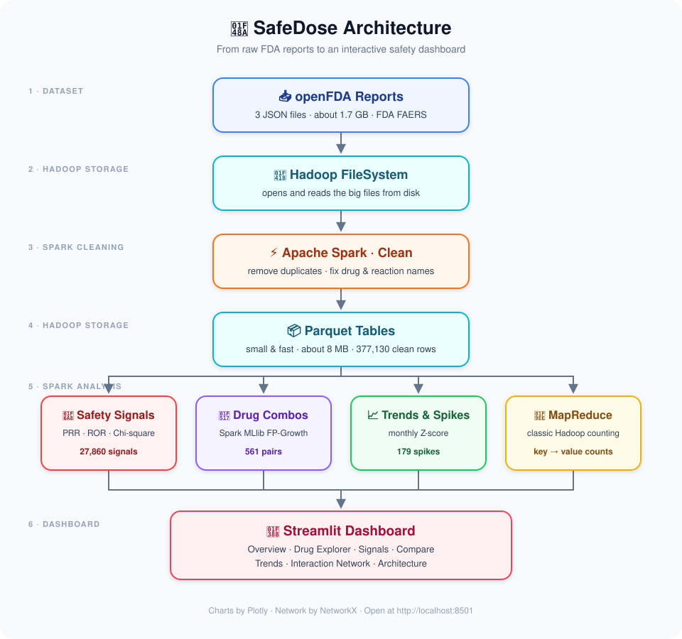

<div align="center">

# 💊 SafeDose

### Find hidden medicine side effects using Big Data


</div>

---

## 🤔 What is SafeDose?

When people take a medicine and something bad happens, a report is sent to the **US FDA**.
There are **millions** of these reports.

**SafeDose reads them, cleans them, and finds which medicines are linked to which side effects** — then shows it all in an easy dashboard.

> ⚠️ **Note:** A "signal" means a drug and a side effect show up together **more often than normal**.
> It does **not** prove the drug caused it. A doctor should check it.

---

## ✨ Features

| | Feature | What it does |
|:-:|---|---|
| 📊 | **Overview** | Quick numbers and charts about all reports |
| 🔍 | **Drug Explorer** | Search any medicine and see its side effects |
| 🚨 | **Safety Signals** | Find drug + side effect pairs that look risky |
| ⚖️ | **Compare Drugs** | Put two medicines side by side |
| 📈 | **Trends & Spikes** | See months where reports suddenly jumped |
| 🕸️ | **Interaction Network** | See which medicines are often taken together |
| 🐘 | **Architecture** | Animated walkthrough of how the data flows |

---

## 🛠️ Tech Stack

| Tool | Used for |
|---|---|
| 🐍 **Python** | The main language |
| 🐘 **Hadoop** | Reading and storing big files |
| ⚡ **Apache Spark** | Cleaning and processing 1.7 GB of data fast |
| 🤖 **Spark MLlib** | Finding medicines taken together (FP-Growth) |
| 📦 **Parquet** | Small, fast data files |
| 🎈 **Streamlit** | The web dashboard |
| 📉 **Plotly + NetworkX** | Interactive charts and graphs |

---

## 🔄 How it works

<div align="center">
  
</div>

1. **📥 Get data** – download FDA report files (1.7 GB)
2. **🐘 Read** – Hadoop opens the big files
3. **⚡ Clean** – Spark removes duplicates and fixes names
4. **📦 Save** – store as small, fast Parquet tables
5. **🧮 Analyse** – find risky pairs, drug combos and sudden spikes
6. **🎈 Show** – see everything in the dashboard

---

## 🚀 How to Use

**You need:** Python 3.10+, Java (JDK 17 or newer), and 4 GB+ RAM.

### 1️⃣ Install

```bash
pip install -r requirements.txt
```

### 2️⃣ Get the dataset

The raw FDA files are too big for GitHub (1.7 GB), so they are on Google Drive.

1. Download the 3 files from 👉 **[Google Drive – SafeDose dataset](PASTE_YOUR_GDRIVE_LINK_HERE)**
   - `drug-event-0001-of-0029.json`
   - `drug-event-0002-of-0029.json`
   - `drug-event-0003-of-0029.json`
2. Put them in the `data/raw/` folder:

```
SafeDose/data/raw/
├── drug-event-0001-of-0029.json
├── drug-event-0002-of-0029.json
└── drug-event-0003-of-0029.json
```

> 💡 **Just want to see the dashboard?** You can skip this step. The cleaned results are already in `data/processed/`, so you can go straight to step 4.

### 3️⃣ Process the data (run in order)

```bash
python src/02_download.py       # check the raw files
python src/03_clean.py          # clean the data
python src/04_signals.py        # find risky drug + side effect pairs
python src/05_interactions.py   # find medicines taken together
python src/06_trends.py         # find sudden spikes
```

### 4️⃣ Open the dashboard

```bash
streamlit run src/app.py
```

Then open 👉 **http://localhost:8501** in your browser.

---

## 📁 Project Folders

```
SafeDose/
├── data/raw/          📥 FDA report files (download from Google Drive)
├── data/processed/    📦 cleaned results (Parquet)
├── docs/              🖼️ architecture picture
├── hadoop/bin/        🐘 Hadoop helper files for Windows
└── src/               🧠 all the code + dashboard (app.py)
```

---

## 📈 Results at a glance

| 📄 Reports | 💊 Drugs | 🚨 Signals found | 🔗 Drug combos | 📈 Spikes |
|:-:|:-:|:-:|:-:|:-:|
| **36,000** | **3,127** | **27,860** | **561** | **179** |

---

<div align="center">

Made with ❤️ using free data from **openFDA**

📘 Want the full explanation? Read [PROJECT_GUIDE.md](PROJECT_GUIDE.md)

</div>
